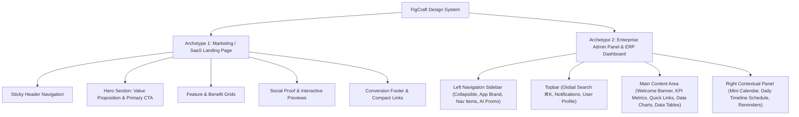

# FigCraft Frontend Design Skill

## 1. Purpose and Scope

Use this skill whenever the task involves designing, structuring, or refining frontend interfaces in **FigCraft**.

This skill is for FigCraft, not Figma. Do not call Figma tools, use Figma-specific APIs, or assume `.fig` compatibility unless the user explicitly requests a migration or confirms compatibility.

The goal is to produce interfaces that are:
- Clean, modern, calm, and professional.
- Highly structured for both marketing websites and data-intensive enterprise admin panels.
- Easy to scan, understand, and operate.
- Consistent across pages, widgets, and components.
- Responsive and structurally robust via strict Auto Layout.
- Ready for clean implementation in the existing frontend stack (React + TypeScript + Tailwind + Vite).
- Free from visual clutter, unnecessary content, and decorative AI-generated noise.

**Design quality is not measured by the number of elements.** Prefer clear, purposeful structure and well-proportioned layout over decorative chaos.

---

## 2. Visual Direction & Design Tokens

### 2.1 Core Visual Identity

The design system is built around a modern, bright, light-mode palette:
- **Bright, clean light-mode canvas**: Soft background tones (`#EFF8FF` / `#F5F8FC`) providing subtle contrast against pure white cards.
- **Pure white elevated surfaces**: Cards, sheets, sidebars, and panels use `#FFFFFF`.
- **Light-blue primary brand**: `#3698E5` and `#237BC8` as the defining identity for active states, CTA buttons, and interactive indicators.
- **Restrained indigo/violet accents**: `#7663E9` for secondary highlights and featured tags.
- **Dark navy text hierarchy**: `#101B33` for strong headings and `#46546A` / `#748198` for body and secondary metadata.
- **Subtle borders & soft shadows**: 1px crisp borders (`#E5EAF1`) and low-opacity shadows (`rgba(16, 27, 51, 0.04)` to `0.08`).

> [!IMPORTANT]
> **COLOR PALETTE CONSISTENCY RULE (STRICT):**
> When referencing external admin panels or ERP designs (such as TeamHub or EduNova), **DO NOT copy foreign primary brand colors** (e.g., TeamHub's green/mint theme). Always map them back to the approved **Light Blue + Navy + Indigo** palette. Mint and green are reserved strictly for positive/success semantic status indicators.

### 2.2 Design Token Palette

| Token | Hex Value | Intended Usage |
|---|---|---|
| `color.brand.50` | `#EFF8FF` | Very pale blue canvas / card hover background |
| `color.brand.100` | `#DCEEFF` | Soft blue surface / badge background |
| `color.brand.200` | `#B9DEFF` | Accent borders and subtle highlights |
| `color.brand.300` | `#83C5F8` | Decorative blue accents and light progress fills |
| `color.brand.500` | `#3698E5` | Main brand blue (badges, icons, sparklines) |
| `color.brand.600` | `#237BC8` | Primary CTA buttons, active navigation, links |
| `color.brand.700` | `#1D5F9E` | Button hover and active states |
| `color.navy.900` | `#101B33` | Main headings, KPI values, high-contrast labels |
| `color.neutral.700` | `#46546A` | Primary body text and table cell data |
| `color.neutral.500` | `#748198` | Secondary labels, timestamps, placeholder text |
| `color.neutral.200` | `#E5EAF1` | Card borders, dividers, table borders |
| `color.neutral.100` | `#F5F8FC` | Main app background, sidebar active track |
| `color.surface` | `#FFFFFF` | Cards, modals, topbar, sidebars |
| `color.accent.indigo`| `#7663E9` | Special AI features, secondary tags |
| `color.status.success`| `#10B981` | Success badges, positive trends, completed |
| `color.status.warning`| `#F59E0B` | Pending actions, warnings, medium risk |
| `color.status.danger` | `#EF4444` | High risk alerts, errors, overdue badges |

### 2.3 Typography & Hierarchy

- **Font Family**: Clean sans-serif (Inter, Plus Jakarta Sans, Geist, or system sans-serif).
- **Display / Page Title**: 24px–28px, Semibold / Bold (`#101B33`).
- **Section / Card Header**: 16px–18px, Semibold (`#101B33`).
- **Metric / KPI Value**: 24px–32px, Bold (`#101B33`).
- **Body / Primary Text**: 14px, Regular / Medium (`#46546A`).
- **Caption / Secondary Text**: 12px, Regular (`#748198`).
- **Micro Badge / Tag**: 11px–12px, Medium (`#237BC8` or semantic status).

### 2.4 Radii & Elevation
- **Corner Radii**:
  - Tags / Badges: `6px`–`8px` or full pill (`9999px`).
  - Buttons & Inputs: `8px`–`10px`.
  - Cards & Panels: `12px`–`16px`.
  - Modals & Drawers: `16px`–`20px`.
- **Borders & Shadows**:
  - Border: 1px solid `#E5EAF1`.
  - Surface Shadow: `0px 1px 3px rgba(16, 27, 51, 0.05), 0px 10px 24px -4px rgba(16, 27, 51, 0.04)`.

---

## 3. Non-Negotiable Auto Layout Policy

**AUTO LAYOUT IS MANDATORY.** Every structural frame in FigCraft must use Auto Layout. Never construct layouts as disconnected, absolutely positioned elements.

### 3.1 Container Hierarchy
1. **Application Shell (Horizontal Auto Layout)**:
   - `Sidebar` (Fixed width, e.g. 240px–260px, Fill vertical).
   - `Main Content Area` (Fill horizontal, Fill vertical, vertical Auto Layout).
   - `Contextual Panel` (Optional right sidebar, Fixed width, e.g. 280px–320px, Fill vertical).
2. **Main Content Container (Vertical Auto Layout)**:
   - `Topbar / Header` (Fill horizontal, Hug vertical).
   - `Scrollable Page Body` (Fill horizontal, Fill/Hug vertical, Gap 20px–24px, Padding 24px–32px).
3. **Card & Widget Containers**:
   - `KPI Grid`: Horizontal Auto Layout or multi-row flex with `Fill` children.
   - `Card`: Vertical Auto Layout, Padding 16px–20px, Gap 12px–16px, `Fill` horizontal.

### 3.2 Sizing Rules
- **Fill**: Main content columns, flexible cards in grids, search bars, table rows, and expanders.
- **Hug**: Button labels, badges, icon slots, tags, chips, and modal content heights.
- **Fixed**: Avatar sizes (32px/40px/48px), icon boxes (20px/24px), sidebar widths (240px/280px).

---

## 4. Content Discipline & Anti-TMI

Admin panels and dashboards naturally hold significant operational data. However:
- **Prioritize by role and task**: Arrange widgets based on what the user needs to act on first.
- **Anti-clutter**: Do not display every database field on the primary screen. Use progressive disclosure (modals, drawers, detail sheets).
- **Card restraint**: Avoid putting cards inside cards without functional separation.
- **Meaningful metrics**: Every KPI stat card must show context (trend line, sparkline, percentage change, or deadline).
- **Table sanity**: Limit visible table columns to 5–7 high-priority fields; place secondary details inside expandable rows or slide-over sheets.

---

## 5. Page Archetypes & Layout Patterns

The skill supports two primary product design archetypes:

### 5.1 Archetype 1: Marketing & SaaS Landing Pages
- **Header**: Logo, 4–5 core links, Sign In / Get Started CTA.
- **Hero**: Clear headline (4–10 words), concise sub-copy (1 sentence), primary + secondary action, product UI preview.
- **Feature Sections**: 3–4 scannable value cards with clear icon/graphic cues.
- **Proof & Footer**: Trust badges or partner logos, compact multi-column footer.

### 5.2 Archetype 2: Enterprise Admin Panels & ERP Dashboards (EduNova / TeamHub Pattern)

#### A. Layout Architecture (3-Column Layout)
1. **Left Navigation Sidebar (Fixed ~250px)**:
   - App Logo & Product Badge (e.g. "EduNova AI ERP 2026").
   - Navigation links with clean icons (`lucide-react`):
     - Core: Dashboard (Active), Classes/Employees, Directory, Attendance, Reports.
     - Specialty: Timetable, AI Tools, Communication, Payroll, Settings.
   - Active item styling: Light-blue fill (`#EFF8FF`), brand-blue text & icon (`#237BC8`), subtle left border highlight or rounded active pill.
   - Bottom Widget: Collapsible AI Assistant or subscription upgrade banner ("Meet Nova AI - Chat with Nova AI").

2. **Top Navigation Bar (Fill horizontal, Height ~64px–72px)**:
   - Global search input with keyboard shortcut pill (`Search students, classes, records... ⌘K`).
   - Right utility cluster: Notification bell with red/blue counter badge, message bubble icon, and User Profile (Avatar + Name + Role e.g., "Ms. Ria - Teacher").

3. **Center Main Content (Fill horizontal)**:
   - **Greeting / Action Banner**:
     - Friendly personal headline ("Good morning, Ms. Ria!").
     - Context summary ("You have 3 classes today and 12 pending tasks.").
     - Quick action CTA ("View My Classes →").
     - Optional contextual AI tool cards (e.g., "AI Lesson Planner", "AI Content Generator").
   - **KPI Stat Cards (4-Column Row)**:
     - Stat 1: Primary active volume (e.g., "Today's Classes: 3") + time subtext + subtle blue trend wave.
     - Stat 2: Total unit count (e.g., "Student Count: 128") + scope subtext.
     - Stat 3: Work in progress (e.g., "Assignments to Grade: 12") + deadline warning.
     - Stat 4: Pending approvals (e.g., "Leave Requests: 2") + action alert.
   - **Quick Action Links**: Horizontal pill row with icons for instant access (Class Roster, Timetable, Attendance, Assignments).
   - **Data Visualization & Analytics Grid (2-Column Auto Layout)**:
     - Donut / Progress chart: Activity completion (e.g. 76% Submissions).
     - Grouped Bar chart: Performance comparison across categories.
     - List / Feed widgets: Recent activity timeline, student risk alerts with risk pills (High/Medium/Low), system notifications.
   - **Data Tables**:
     - Search & filter toolbar above table.
     - Strict table row height (48px–56px).
     - Status badges: Soft colored pills with solid dots (e.g. Green for Approved/Active, Yellow for Pending, Red for Overdue).
     - Row action buttons (View, Edit, More menu).
     - Bottom pagination bar (Items per page, record count, prev/next controls).

4. **Right Contextual Panel (Fixed ~300px, Collapsible on smaller screens)**:
   - **Interactive Mini Calendar**: Month navigation, active day highlight in brand blue (`#237BC8`).
   - **Today's Timeline / Schedule**: Chronological cards with time stamps, room numbers, and a vibrant "Now" badge on the active slot.
   - **Smart Reminders**: List with colored category icons and quick navigation arrows.

---

## 6. Components & Reusable Design System

Standardize these foundational components in FigCraft:
- **Buttons**:
  - `Primary`: Solid `#237BC8`, white text, 8px radius.
  - `Secondary`: `#EFF8FF` background, `#237BC8` text, 1px border `#B9DEFF`.
  - `Ghost / Outline`: Transparent background, 1px border `#E5EAF1`, `#46546A` text.
  - `Danger`: Solid `#EF4444` or soft red badge `#FEE2E2`.
- **Badges & Status Tags**:
  - `Success`: Background `#ECFDF5`, text `#059669`, border `#A7F3D0`.
  - `Warning`: Background `#FFFBEB`, text `#D97706`, border `#FDE68A`.
  - `Danger`: Background `#FEF2F2`, text `#DC2626`, border `#FECACA`.
  - `Info / Brand`: Background `#EFF8FF`, text `#237BC8`, border `#B9DEFF`.
- **Inputs & Search Bars**:
  - Height 40px–44px, 1px border `#E5EAF1`, background `#FFFFFF` or `#F5F8FC`.
  - Prefix icon (Search, Filter, Date) + suffix shortcut tag (`⌘K`).
- **Cards & Data Containers**:
  - 1px border `#E5EAF1`, corner radius 12px–16px, background `#FFFFFF`.

---

## 7. Responsive Breakpoints & Adaptations

- **Desktop (1440px+)**: Full 3-column layout (Sidebar + Main Content + Right Contextual Panel).
- **Laptop / Small Desktop (1024px–1280px)**: 2-column layout (Sidebar + Main Content; Right Contextual Panel collapses into a drawer or bottom tab).
- **Tablet (768px–1023px)**: Collapsed icon-only sidebar (64px) or off-canvas hamburger drawer; 2-column KPI cards; horizontal scrolling tables.
- **Mobile (390px–430px)**: Single column flow; sticky top header with hamburger menu; 1-column stacked KPI cards; card list view replacing wide tables.

---

## 8. Curated React Frontend Stack Alignment

When handing off designs to code, use this proven, lightweight stack:
- **Framework**: React + TypeScript + Vite.
- **Styling**: Tailwind CSS + `clsx` + `tailwind-merge`.
- **Icons**: `lucide-react` (preferred default, clean outline style).
- **UI Primitives**: `radix-ui` / `shadcn/ui` (accessible, copy-owned).
- **Data Tables**: `@tanstack/react-table` (headless, high-performance).
- **Charts**: `recharts` (simple SVG charts) or `echarts-for-react` (complex enterprise analytics).
- **Forms**: `react-hook-form` + `zod`.
- **Date Utilities**: `date-fns`.
- **Notifications**: `sonner`.

---

## 9. FigCraft Headless Operating Workflow

FigCraft operates via the headless MCP engine in this environment:
1. **Document Inspection**:
   - Call `inspect_document` with `{outline: true}` or specific fields to observe the layer tree and page structure.
2. **Node Creation & Modification**:
   - Use `create_node` with appropriate `type` (`FRAME`, `TEXT`, `RECTANGLE`, etc.) and parent `id`.
   - Always apply Auto Layout (`layout: "HORIZONTAL"` or `"VERTICAL"`, `gap`, `padding`, `mainAlign`, `crossAlign`).
   - Set properties with `set_properties` (`fills`, `strokes`, `cornerRadius`, `sizingH`, `sizingV`).
3. **Batch Operations**:
   - Wrap multi-element creation into `batch` commands for clean single-step transactions and undo history.
4. **Visual Verification**:
   - Take screenshots via `screenshot` to verify visual hierarchy, spacing, typography, and contrast.
   - Fix overlaps, incorrect sizing, or clipped content immediately.

---

## 10. Verification & Completion Report

Every design task completed with FigCraft must conclude with:
1. **Status**: COMPLETED / PARTIAL / BLOCKED.
2. **Screens & Views**: Name of frames created/modified and target viewports.
3. **Design Tokens & Palette**: Verified compliance with the Light Blue + Navy identity.
4. **Auto Layout Audit**: Confirmation that Auto Layout is strictly applied (no floating absolute elements).
5. **Component & Layout Inventory**: Summary of sidebars, topbars, KPI cards, tables, and contextual panels.
6. **Visual Proof**: Screenshot verification result.
7. **Next Step**: Design handoff or code implementation plan.
