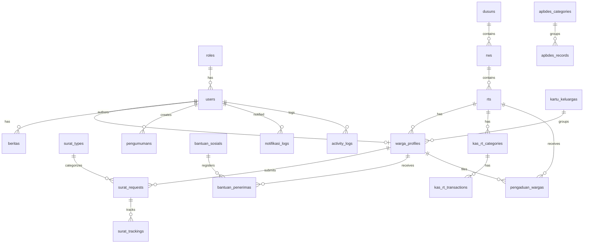

# 📋 SiDesKu — Product Requirements Document (PRD)
### Sistem Informasi Desa & Digitalisasi Layanan Publik Terpadu
**Versi:** 1.0 · **Tanggal:** September 2026 · **Penulis:** No People

---

## 📌 Daftar Isi

1. [Ringkasan Eksekutif](#1-ringkasan-eksekutif)
2. [Analisis Kondisi Saat Ini (As-Is)](#2-analisis-kondisi-saat-ini-as-is)
3. [Skema Database Lengkap](#3-skema-database-lengkap)
4. [Matriks Role & Hak Akses](#4-matriks-role--hak-akses)
5. [Arsitektur Sistem](#5-arsitektur-sistem)
6. [Inventarisasi API Endpoint](#6-inventarisasi-api-endpoint)
7. [Gap Analysis & Kekurangan Backend](#7-gap-analysis--kekurangan-backend)
8. [Spesifikasi Fitur Lengkap](#8-spesifikasi-fitur-lengkap)
9. [Spesifikasi UI/UX per Role](#9-spesifikasi-uiux-per-role)
10. [Roadmap Pengembangan Lanjutan](#10-roadmap-pengembangan-lanjutan)

---

## 1. Ringkasan Eksekutif

**SiDesKu** adalah platform *Smart Village & E-Government* berbasis web yang mentransformasi pelayanan administratif Desa Doko (Kecamatan Ngasem, Kabupaten Kediri, Jawa Timur) menjadi sistem digital terpadu.

**Stack Teknologi:**
- **Frontend:** React 19 + TypeScript + Tailwind CSS v4 + Vite + React Router v7 + TanStack Query v5
- **Backend:** Laravel 13 + PHP 8.4+ + MySQL + Laravel Sanctum (Token Auth)
- **QR Code:** `simplesoftwareio/simple-qrcode` (SVG format, SHA-256 hash)
- **State Management:** React Context (AuthContext) + TanStack Query
- **Arsitektur Frontend:** Feature-Driven Architecture (per-modul)
- **Arsitektur Backend:** Modular Role-Based RESTful API Controllers

---

## 2. Analisis Kondisi Saat Ini (As-Is)

### 2.1 Kondisi Backend — Yang Sudah Ada ✅

| Modul | File Controller | Status |
| :--- | :--- | :--- |
| Autentikasi (Login, Register, Profile, Password, Logout) | `Auth/AuthController.php` | ✅ Lengkap |
| Surat — Warga (Ajukan, Lihat, Detail) | `Warga/WargaSuratController.php` | ✅ Ada |
| Surat — RT (Lihat, Approve, Reject) | `Rt/RtSuratController.php` | ✅ Ada |
| Surat — RW (Lihat, Approve, Reject) | `Rw/RwSuratController.php` | ✅ Ada |
| Surat — Sekdes (Lihat, Process/Legalisasi, Reject) | `Sekdes/SekdesSuratController.php` | ✅ Ada |
| QR Code Generator & Verifikasi Publik | `Public/PublicSuratController.php` | ✅ Ada |
| Tracking Surat Publik | `Public/PublicSuratController.php` | ✅ Ada |
| APBDes (Summary publik, CRUD realisasi) | `Bendahara/ApbdesController.php` | ✅ Ada |
| Kas RT (Lihat, Tambah Kategori, Tambah Transaksi) | `Rt/KasRtController.php` | ✅ Ada |
| Bansos (CRUD, Tambah Penerima, Publish, Verifikasi QR) | `Sekdes/BansosController.php` | ✅ Ada |
| Pengaduan Warga (Kirim, Lihat) | `Warga/PengaduanController.php` | ✅ Ada |
| Pengaduan RT (Lihat, Tanggapi) | `Rt/RtPengaduanController.php` | ✅ Ada |
| Data Warga & KK (Read-only) | `Admin/WargaController.php` | ✅ Parsial |
| Info Publik (Berita, Pengumuman, Stats, Home) | `Public/PublicInfoController.php` | ✅ Ada |
| Pengaturan Desa / Kop Surat | `Sekdes/DesaSettingController.php` | ✅ Ada |
| Notifikasi Log | `Public/PublicInfoController.php` | ✅ Parsial |

### 2.2 Kondisi Frontend — Komponen yang Ada ✅

| Komponen | File | Ukuran |
| :--- | :--- | :--- |
| Dashboard Layout (sidebar, nav, notifikasi) | `DashboardLayout.tsx` | 34 KB |
| Dashboard Warga (surat, pengaduan, notifikasi) | `WargaDashboard.tsx` | 56 KB |
| Dashboard RT | `RtDashboard.tsx` | 58 KB |
| Dashboard RW | `RwDashboard.tsx` | 15 KB |
| Dashboard Sekdes | `SekdesDashboard.tsx` | 29 KB |
| Dashboard Bendahara | `BendaharaDashboard.tsx` | 21 KB |
| Modal Cetak Surat PDF | `CetakSuratModal.tsx` | 16 KB |
| Modal QR Verifikasi | `QrVerificationModal.tsx` | 38 KB |
| Modal Tracking Surat | `SuratTrackingModal.tsx` | 20 KB |
| Manajemen Bansos | `BansosManager.tsx` | 16 KB |
| Pengaturan Kop Surat | `KopSuratSetting.tsx` | 11 KB |
| Views Umum (Pengumuman, Agenda, Profil, Notifikasi) | `RoleDashboardViews.tsx` | 55 KB |
| Landing Page (Home) | `HomePage.tsx` | 53 KB |
| Halaman Lacak Surat | `LacakSuratPage.tsx` | 20 KB |
| Halaman Layanan Surat | `LayananSuratPage.tsx` | 21 KB |
| Halaman APBDes Publik | `TransparansiApbdesPage.tsx` | 13 KB |
| Halaman Bansos Publik | `BansosPage.tsx` | 19 KB |
| Halaman Berita Publik | `BeritaPage.tsx` | 14 KB |
| Profil Desa Publik | `ProfilDesaPage.tsx` | 29 KB |

---

## 3. Skema Database Lengkap

### ERD Overview



### 3.1 Tabel `roles`

| Kolom | Tipe | Keterangan |
|:---|:---|:---|
| `id` | BIGINT PK | Auto increment |
| `name` | VARCHAR(50) | Nama role |
| `slug` | VARCHAR(50) UNIQUE | admin, kades, sekdes, bendahara_desa, rw, rt, sekretaris_rt, bendahara_rt, warga |
| `display_name` | VARCHAR(100) | Nama tampilan |
| `description` | TEXT NULL | Deskripsi akses |

**Daftar Role:**
| Slug | Display Name | Level |
|:---|:---|:---|
| `admin` | Administrator Sistem | Super Admin |
| `kades` | Kepala Desa | Pimpinan Desa |
| `sekdes` | Sekretaris Desa | Perangkat Inti |
| `bendahara_desa` | Kaur Keuangan / Bendahara | Perangkat Keuangan |
| `rw` | Ketua RW | Tingkat RW |
| `rt` | Ketua RT | Tingkat RT |
| `sekretaris_rt` | Sekretaris RT | Staf RT |
| `bendahara_rt` | Bendahara RT | Staf RT |
| `warga` | Warga Masyarakat | Pengguna Akhir |

### 3.2 Tabel `users`

| Kolom | Tipe | Keterangan |
|:---|:---|:---|
| `id` | BIGINT PK | |
| `role_id` | FK → roles | |
| `name` | VARCHAR | Nama lengkap |
| `username` | VARCHAR UNIQUE | Username login |
| `email` | VARCHAR UNIQUE | Email |
| `phone_number` | VARCHAR(20) NULL | No HP |
| `avatar` | TEXT NULL | URL/Base64 avatar |
| `email_verified_at` | TIMESTAMP NULL | |
| `password` | VARCHAR | Bcrypt hash |
| `is_active` | BOOLEAN | Aktif/Nonaktif |
| `last_login_at` | TIMESTAMP NULL | |
| `remember_token` | VARCHAR NULL | |

### 3.3 Tabel `desa_settings`

| Kolom | Tipe | Keterangan |
|:---|:---|:---|
| `nama_desa` | VARCHAR | |
| `kode_desa` | VARCHAR(20) | |
| `kecamatan/kabupaten/provinsi` | VARCHAR | Wilayah |
| `kode_pos` | VARCHAR(10) | |
| `alamat_kantor` | VARCHAR | |
| `telepon/email/website` | VARCHAR NULL | |
| `kop_atas/kop_tengah/kop_bawah` | VARCHAR | Identitas kop surat |
| `kop_footer` | TEXT NULL | Footer surat |
| `logo_desa_path/logo_kabupaten_path` | VARCHAR NULL | Path logo |
| `nama_kades/nip_kades` | VARCHAR | |
| `nama_sekdes/nip_sekdes` | VARCHAR | |
| `ttd_kades_image/stempel_desa_image` | VARCHAR NULL | Gambar TTD/stempel |

### 3.4 Tabel Wilayah (`dusuns`, `rws`, `rts`)

**dusuns:** `id`, `nama_dusun`, `kode_dusun`, `kepala_dusun`

**rws:** `id`, `dusun_id` FK, `nomor_rw`, `ketua_rw_user_id` FK NULL

**rts:** `id`, `rw_id` FK, `nomor_rt`, `ketua_rt_user_id` FK NULL, `sekretaris_rt_user_id` FK NULL, `bendahara_rt_user_id` FK NULL

### 3.5 Tabel `kartu_keluargas`

| Kolom | Tipe | Keterangan |
|:---|:---|:---|
| `no_kk` | VARCHAR(20) UNIQUE | Nomor KK |
| `nama_kepala_keluarga` | VARCHAR(150) | |
| `rt_id` | FK → rts | |
| `alamat_lengkap` | TEXT | |
| `no_telp_rumah` | VARCHAR(20) NULL | |
| `foto_kk` | VARCHAR NULL | Path foto KK |

### 3.6 Tabel `warga_profiles`

| Kolom | Tipe | Keterangan |
|:---|:---|:---|
| `user_id` | FK → users NULL | Account terhubung |
| `kk_id` | FK → kartu_keluargas NULL | |
| `rt_id` | FK → rts | |
| `nik` | VARCHAR(20) UNIQUE | |
| `nama_lengkap` | VARCHAR(150) | |
| `tempat_lahir` | VARCHAR(100) | |
| `tanggal_lahir` | DATE | |
| `jenis_kelamin` | ENUM: L/P | |
| `agama` | VARCHAR(30) | |
| `status_perkawinan` | VARCHAR(30) | |
| `pekerjaan` | VARCHAR(100) NULL | |
| `pendidikan_terakhir` | VARCHAR(50) NULL | |
| `golongan_darah` | VARCHAR(5) NULL | |
| `no_hp_wa` | VARCHAR(25) NULL | Untuk broadcast |
| `alamat_ktp` | TEXT | |
| `foto_ktp` | VARCHAR NULL | |
| `status_keluarga` | ENUM: Kepala Keluarga/Suami/Istri/Anak/Famili Lain | |
| `status_ekonomi` | ENUM: Mampu/Menengah/Kurang Mampu (PKH/BLT Eligible) | |
| `status_kependudukan` | ENUM: Tetap/Pindah/Meninggal | |

### 3.7 Tabel `surat_types`

| Kolom | Tipe | Keterangan |
|:---|:---|:---|
| `kode_surat` | VARCHAR(20) UNIQUE | SKTM, SKU, SKD, SKTP, dll. |
| `nama_surat` | VARCHAR(150) | |
| `format_nomor` | VARCHAR(100) | `470/{NO}/418.66.04/{TAHUN}` |
| `template_body` | LONGTEXT NULL | Narasi isi surat |
| `persyaratan_json` | JSON NULL | Array persyaratan |
| `masa_berlaku_hari` | INT | Default 30 hari |
| `is_active` | BOOLEAN | |

**Jenis Surat yang Ada (dari Seeder):**

| Kode | Nama Surat |
|:---|:---|
| SKTP | Surat Pengantar Pembuatan/Rekam KTP-el |
| SKKK | Surat Pengantar Kartu Keluarga Baru/Perubahan |
| SKTM | Surat Keterangan Tidak Mampu |
| SKU | Surat Keterangan Usaha |
| SKD | Surat Keterangan Domisili |
| SKNIK | Surat Keterangan Nikah (Model N1-N4) |
| SKK | Surat Keterangan Kelahiran |
| SKKM | Surat Keterangan Kematian |
| SKIK | Surat Izin Keramaian |
| SKB | Surat Keterangan Belum Menikah |

### 3.8 Tabel `surat_requests`

| Kolom | Tipe | Keterangan |
|:---|:---|:---|
| `nomor_resi` | VARCHAR(40) UNIQUE | `REQ-20260818-XXXXXX` |
| `warga_profile_id` | FK → warga_profiles | |
| `surat_type_id` | FK → surat_types | |
| `nomor_surat_resmi` | VARCHAR(100) NULL | Diterbitkan saat selesai |
| `status` | ENUM | draft / pending_rt / approved_rt / pending_rw / approved_rw / processed_sekdes / completed / rejected |
| `keperluan` | TEXT | Isian pemohon |
| `form_data_json` | JSON NULL | Data formulir dinamis |
| `file_lampiran` | VARCHAR NULL | Path lampiran |
| `file_surat_pdf` | VARCHAR NULL | Path PDF jadi |
| `qr_verification_hash` | VARCHAR(64) UNIQUE | SHA-256 hash |
| `ttd_sekdes_at` | TIMESTAMP NULL | |
| `ttd_kades_at` | TIMESTAMP NULL | |
| `catatan_penolakan` | TEXT NULL | |

**Alur Status Surat:**
```
[draft] → [pending_rt] → [approved_rt] → [pending_rw] → [approved_rw] → [processed_sekdes] → [completed]
                ↓                 ↓                ↓                                 ↓
            [rejected]        [rejected]       [rejected]                        [rejected]
```

> [!WARNING]
> **Bug / Inkonsistensi Alur:** `RtSuratController@approveRt` langsung set status ke `processed_sekdes` (melewati `approved_rt` dan `pending_rw`), sehingga tahap **verifikasi RW dilewati**. Alur yang benar seharusnya: `pending_rt → approved_rt → pending_rw → approved_rw → processed_sekdes`.

### 3.9 Tabel `surat_trackings`

| Kolom | Tipe | Keterangan |
|:---|:---|:---|
| `surat_request_id` | FK | |
| `actor_user_id` | FK NULL | |
| `status_stage` | VARCHAR(50) | RT / RW / Sekdes / Sistem |
| `status_action` | ENUM | Diajukan/Disetujui/Ditolak/Revisi/Ditandatangani/Selesai |
| `catatan` | TEXT NULL | |

### 3.10 Tabel Keuangan

**apbdes_categories:** `jenis` (Pendapatan/Belanja/Pembiayaan), `kode_rekening`, `nama_kategori`

**apbdes_records:** `category_id`, `tahun_anggaran`, `uraian`, `anggaran`, `realisasi`, `tanggal_realisasi`, `bukti_transaksi_file`, `created_by_user_id`

**kas_rt_categories:** `rt_id`, `nama_kategori`, `tipe` (Pemasukan/Pengeluaran)

**kas_rt_transactions:** `rt_id`, `category_id`, `warga_profile_id`, `tanggal_transaksi`, `tipe`, `jumlah`, `keterangan`, `bukti_pembayaran_file`, `created_by_user_id`

### 3.11 Tabel Bansos

**bantuan_sosials:** `nama_bantuan`, `sumber_dana`, `tahun`, `tahap`, `kuota_penerima`, `nominal_per_penerima`, `tanggal_penyaluran`, `waktu_mulai`, `lokasi_penyaluran`, `deskripsi`, `status` (draft/published/selesai), `published_at`, `created_by_user_id`

**bantuan_penerimas:** `bantuan_sosial_id`, `warga_profile_id`, `kk_id`, `nomor_antrean`, `qr_bantuan_code` UNIQUE, `status_penyaluran` (Terdaftar/Siap Diambil/Sudah Disalurkan), `disalurkan_at`, `petugas_user_id`, `catatan`

### 3.12 Tabel Komunikasi

**pengaduan_wargas:** `warga_profile_id`, `rt_id`, `kategori`, `judul`, `deskripsi`, `foto_lampiran`, `status` (Terkirim/Ditinjau RT/Diproses Desa/Selesai/Ditolak), `tanggapan`, `ditanggapi_by_user_id`, `ditanggapi_at`

**notifikasi_logs:** `user_id`, `warga_profile_id`, `nomor_tujuan`, `jenis_notifikasi`, `judul`, `pesan`, `status_pengiriman` (TERKIRIM/GAGAL/PENDING), `payload_json`

**activity_logs:** `user_id`, `action`, `entity_type`, `entity_id`, `description`, `ip_address`, `user_agent`

**beritas:** `judul`, `slug`, `kategori`, `ringkasan`, `konten`, `gambar_cover`, `view_count`, `is_published`, `published_at`, `author_id`

**pengumumans:** `judul`, `isi`, `level_target` (Semua/Dusun/RW/RT), `target_id`, `file_lampiran`, `tanggal_mulai`, `tanggal_selesai`, `is_active`, `created_by_user_id`

---

## 4. Matriks Role & Hak Akses

### 4.1 Role Definitions

```
┌─────────────────────────────────────────────────────────────────────────────────┐
│                    HIRARKI SISTEM SIDESKU                                       │
│                                                                                 │
│  [👑 Admin]          ← Akses penuh sistem & konfigurasi master data             │
│  [🎖️ Kepala Desa]    ← Monitoring analytics, laporan, approval kebijakan        │
│  [🏛️ Sekdes]         ← Legalisasi surat, bansos, pengaturan desa                │
│  [💰 Bendahara Desa] ← APBDes & laporan keuangan desa                          │
│  [🏢 RW]             ← Validasi surat berjenjang dari RT                        │
│  [📋 RT]             ← Persetujuan surat warga, kas RT, data kependudukan       │
│  [📝 Sekretaris RT]  ← Bantu pencatatan administrasi RT                        │
│  [💵 Bendahara RT]   ← Kas dan iuran warga RT                                  │
│  [👨‍👩‍👧 Warga]          ← Pengajuan surat, tracking, pengaduan, bansos            │
│  [🌐 Publik/Tamu]    ← Landing page, verifikasi QR, lacak surat (tanpa login)  │
└─────────────────────────────────────────────────────────────────────────────────┘
```

### 4.2 Matriks Akses Lengkap

| Fitur | Publik | Warga | RT | Sekretaris RT | Bendahara RT | RW | Sekdes | Bendahara | Kades | Admin |
|:---|:---:|:---:|:---:|:---:|:---:|:---:|:---:|:---:|:---:|:---:|
| **AUTENTIKASI** | | | | | | | | | | |
| Login / Register | ✅ | ✅ | ✅ | ✅ | ✅ | ✅ | ✅ | ✅ | ✅ | ✅ |
| Update Profil | ❌ | ✅ | ✅ | ✅ | ✅ | ✅ | ✅ | ✅ | ✅ | ✅ |
| **LAYANAN SURAT** | | | | | | | | | | |
| Lihat Jenis Surat (Katalog) | ✅ | ✅ | ✅ | ✅ | ✅ | ✅ | ✅ | ❌ | ✅ | ✅ |
| Ajukan Surat Baru | ❌ | ✅ | ❌ | ❌ | ❌ | ❌ | ❌ | ❌ | ❌ | ❌ |
| Lihat Surat Sendiri | ❌ | ✅ | 🟡 | 🟡 | ❌ | 🟡 | ✅ | ❌ | ✅ | ✅ |
| Approve/Reject Surat (RT) | ❌ | ❌ | ✅ | ✅ | ❌ | ❌ | ❌ | ❌ | ❌ | ❌ |
| Approve/Reject Surat (RW) | ❌ | ❌ | ❌ | ❌ | ❌ | ✅ | ❌ | ❌ | ❌ | ❌ |
| Legalisasi Surat (Sekdes) | ❌ | ❌ | ❌ | ❌ | ❌ | ❌ | ✅ | ❌ | ❌ | ❌ |
| Cetak PDF Surat | ❌ | ✅ | ✅ | ✅ | ❌ | ✅ | ✅ | ❌ | ✅ | ✅ |
| Lacak Resi (Publik) | ✅ | ✅ | ✅ | ✅ | ✅ | ✅ | ✅ | ✅ | ✅ | ✅ |
| Verifikasi QR Code | ✅ | ✅ | ✅ | ✅ | ✅ | ✅ | ✅ | ✅ | ✅ | ✅ |
| CRUD Jenis Surat (Master) | ❌ | ❌ | ❌ | ❌ | ❌ | ❌ | 🟡 | ❌ | ❌ | ✅ |
| **KEUANGAN** | | | | | | | | | | |
| Lihat APBDes (Publik) | ✅ | ✅ | ✅ | ✅ | ✅ | ✅ | ✅ | ✅ | ✅ | ✅ |
| Input/Edit APBDes | ❌ | ❌ | ❌ | ❌ | ❌ | ❌ | ❌ | ✅ | ✅ | ✅ |
| Lihat Kas RT | ❌ | ❌ | ✅ | ✅ | ✅ | ❌ | ❌ | ❌ | ❌ | ✅ |
| Input Transaksi Kas RT | ❌ | ❌ | ✅ | ✅ | ✅ | ❌ | ❌ | ❌ | ❌ | ❌ |
| **KEPENDUDUKAN** | | | | | | | | | | |
| Lihat Data Warga | ❌ | ❌ | ✅ | ✅ | ❌ | ✅ | ✅ | ❌ | ✅ | ✅ |
| Lihat Data KK | ❌ | ❌ | ✅ | ✅ | ❌ | ✅ | ✅ | ❌ | ✅ | ✅ |
| CRUD Warga & KK | ❌ | ❌ | ❌ | ❌ | ❌ | ❌ | 🟡 | ❌ | ❌ | ✅ |
| **BANSOS** | | | | | | | | | | |
| Lihat Program Bansos (Publik) | ✅ | ✅ | ✅ | ✅ | ✅ | ✅ | ✅ | ✅ | ✅ | ✅ |
| Kelola Bansos (CRUD, Penerima, Publish) | ❌ | ❌ | ❌ | ❌ | ❌ | ❌ | ✅ | ❌ | ✅ | ✅ |
| Verifikasi Penyaluran Bansos | ❌ | ❌ | ❌ | ❌ | ❌ | ❌ | ✅ | ❌ | ❌ | ✅ |
| **PENGADUAN** | | | | | | | | | | |
| Ajukan Pengaduan | ❌ | ✅ | ❌ | ❌ | ❌ | ❌ | ❌ | ❌ | ❌ | ❌ |
| Lihat Pengaduan Sendiri | ❌ | ✅ | ❌ | ❌ | ❌ | ❌ | ❌ | ❌ | ❌ | ❌ |
| Lihat & Tanggapi Pengaduan RT | ❌ | ❌ | ✅ | ✅ | ❌ | ❌ | ✅ | ❌ | ✅ | ✅ |
| **INFORMASI PUBLIK** | | | | | | | | | | |
| Lihat Berita & Pengumuman | ✅ | ✅ | ✅ | ✅ | ✅ | ✅ | ✅ | ✅ | ✅ | ✅ |
| CRUD Berita & Pengumuman | ❌ | ❌ | ❌ | ❌ | ❌ | ❌ | ✅ | ❌ | ✅ | ✅ |
| **PENGATURAN SISTEM** | | | | | | | | | | |
| Update Kop Surat & Info Desa | ❌ | ❌ | ❌ | ❌ | ❌ | ❌ | ✅ | ❌ | ❌ | ✅ |
| Manajemen User | ❌ | ❌ | ❌ | ❌ | ❌ | ❌ | ❌ | ❌ | ❌ | ✅ |
| Manajemen Wilayah (RT/RW/Dusun) | ❌ | ❌ | ❌ | ❌ | ❌ | ❌ | ❌ | ❌ | ❌ | ✅ |

🟡 = Akses parsial/terbatas (hanya wilayah sendiri)

---

## 5. Arsitektur Sistem

```
┌──────────────────────────────────────────────────────────────┐
│                    FRONTEND (Vite + React 19)                │
│                   http://localhost:5173                       │
│                                                              │
│  ┌──────────────┐  ┌────────────────┐  ┌─────────────────┐  │
│  │  Public Pages│  │  Auth Pages    │  │  Dashboard      │  │
│  │  (Landing,   │  │  (Login,       │  │  (Protected,    │  │
│  │   Lacak,     │  │   Register)    │  │  Role-Based     │  │
│  │   Bansos,    │  └────────────────┘  │  Views)         │  │
│  │   APBDes)    │                      └─────────────────┘  │
│  └──────────────┘                                            │
│           │                     │                            │
│           └─────────────────────┘                            │
│                       │                                      │
│              axios + Bearer Token                            │
└──────────────────────────────────────────────────────────────┘
                         │
              ┌──────────┴──────────┐
              │   vite.config proxy │
              │   /api → :8000/api  │
              └──────────┬──────────┘
                         │
┌────────────────────────┼────────────────────────────────────┐
│                 BACKEND (Laravel 13)                         │
│                   http://localhost:8000                      │
│                                                              │
│  routes/api.php  ─→  Auth Middleware (Sanctum)              │
│                       │                                      │
│  ┌────────────────────┼───────────────────────────────────┐  │
│  │ Controllers/Api/   │                                   │  │
│  │  ├── Auth/         │  ├── Rt/                          │  │
│  │  ├── Admin/        │  ├── Rw/                          │  │
│  │  ├── Public/       │  ├── Sekdes/                      │  │
│  │  ├── Warga/        │  └── Bendahara/                   │  │
│  └────────────────────┴───────────────────────────────────┘  │
│                       │                                      │
│           Eloquent ORM (Models)                              │
│                       │                                      │
│         ┌─────────────┴──────────────┐                       │
│         │        MySQL Database       │                       │
│         │  (15+ tables, migrations)   │                       │
│         └────────────────────────────┘                       │
└──────────────────────────────────────────────────────────────┘
```

---

## 6. Inventarisasi API Endpoint

### 6.1 Public Routes (No Auth)

| Metode | Endpoint | Controller | Deskripsi |
|:---|:---|:---|:---|
| `POST` | `/api/auth/login` | AuthController | Login dengan username/email/NIK |
| `POST` | `/api/auth/register` | AuthController | Daftar akun warga baru |
| `GET` | `/api/settings/desa` | DesaSettingController | Info desa untuk kop surat |
| `GET` | `/api/public/beritas` | PublicInfoController | 6 berita terbaru |
| `GET` | `/api/public/pengumumans` | PublicInfoController | 5 pengumuman aktif |
| `GET` | `/api/public/stats` | PublicInfoController | Statistik demografi desa |
| `GET` | `/api/public/home` | PublicInfoController | Data lengkap landing page |
| `GET` | `/api/public/apbdes/summary` | ApbdesController | Ringkasan APBDes per tahun |
| `GET` | `/api/surat-types` | PublicSuratController | Katalog jenis surat |
| `GET` | `/api/public/surat/track` | PublicSuratController | Lacak surat by resi/NIK/hash |
| `GET` | `/api/public/surat/verify-qr/{hash}` | PublicSuratController | Verifikasi keaslian QR |
| `GET` | `/api/public/surat/qr/{hash?}` | PublicSuratController | Render SVG QR Code |

### 6.2 Protected Routes (auth:sanctum)

#### Auth & Profile

| Metode | Endpoint | Deskripsi |
|:---|:---|:---|
| `GET` | `/api/auth/user` | Get current user |
| `GET` | `/api/auth/me` | Get current user (alias) |
| `PUT/POST` | `/api/auth/profile` | Update profil & avatar |
| `PUT/POST` | `/api/auth/password` | Ganti password |
| `POST` | `/api/auth/logout` | Logout & hapus token |
| `GET` | `/api/notifikasi-logs` | Notifikasi user |

#### Surat (Role-based dispatch)

| Metode | Endpoint | Akses | Deskripsi |
|:---|:---|:---|:---|
| `GET` | `/api/surats` | Semua role | Daftar surat (filtered by role) |
| `POST` | `/api/surats` | Warga | Ajukan surat baru |
| `GET` | `/api/surats/{id}` | Semua | Detail surat + desa setting |
| `POST` | `/api/surats/{id}/approve-rt` | RT | Setujui surat |
| `POST` | `/api/surats/{id}/rt-action` | RT | Handle approve/reject |
| `POST` | `/api/surats/{id}/approve-rw` | RW | Setujui surat RW |
| `POST` | `/api/surats/{id}/process-sekdes` | Sekdes | Legalisasi & terbitkan nomor |
| `POST` | `/api/surats/{id}/reject` | RT/RW/Sekdes | Tolak pengajuan |

#### Keuangan & Kas

| Metode | Endpoint | Akses | Deskripsi |
|:---|:---|:---|:---|
| `GET` | `/api/kas-rt` | RT/Sekretaris RT | Laporan kas + kategori + transaksi |
| `POST` | `/api/kas-rt/categories` | RT | Tambah kategori kas |
| `POST` | `/api/kas-rt/transactions` | RT | Catat transaksi |
| `GET` | `/api/apbdes/categories` | Bendahara | Kategori APBDes |
| `POST` | `/api/apbdes/records` | Bendahara | Tambah pos realisasi |
| `PUT` | `/api/apbdes/records/{id}` | Bendahara | Edit pos realisasi |
| `DELETE` | `/api/apbdes/records/{id}` | Bendahara | Hapus pos |

#### Bansos

| Metode | Endpoint | Akses | Deskripsi |
|:---|:---|:---|:---|
| `GET` | `/api/bansos` | Sekdes | Daftar program bansos |
| `POST` | `/api/bansos` | Sekdes | Buat program bansos |
| `GET` | `/api/bansos/{id}` | Sekdes | Detail + daftar penerima |
| `POST` | `/api/bansos/{id}/penerima` | Sekdes | Tambah penerima |
| `POST` | `/api/bansos/{id}/publish-broadcast` | Sekdes | Publish & kirim notifikasi |
| `POST` | `/api/bansos/{id}/verify-disalurkan` | Sekdes | Verifikasi pengambilan |

#### Data Warga & Wilayah

| Metode | Endpoint | Akses | Deskripsi |
|:---|:---|:---|:---|
| `GET` | `/api/warga` | RT/Admin | Data warga (filtered by RT/Admin) |
| `GET` | `/api/warga/kartu-keluarga` | Admin | Semua KK |
| `GET` | `/api/wilayah` | Semua | Data RT/RW struktur |

#### Pengaduan

| Metode | Endpoint | Akses | Deskripsi |
|:---|:---|:---|:---|
| `GET` | `/api/pengaduan` | Warga/RT | Daftar pengaduan (filtered) |
| `POST` | `/api/pengaduan` | Warga | Kirim pengaduan |
| `POST` | `/api/pengaduan/{id}/respond` | RT | Beri tanggapan |

#### Role-Specific Prefixes (Duplikat via Prefix)

> Semua route di bawah ini merupakan duplikasi dengan prefix `/admin`, `/warga`, `/rt`, `/rw`, `/sekdes`, `/bendahara` untuk kejelasan konsumsi frontend.

---

## 7. Gap Analysis & Kekurangan Backend

### 7.1 🔴 Bug Kritis — Alur Persetujuan Surat

**Masalah:** `RtSuratController::approveRt()` langsung set status ke `processed_sekdes`, **melewati tahap RW sepenuhnya**.

```php
// CURRENT (Salah):
$surat->update(['status' => 'processed_sekdes']); // Langsung ke Sekdes

// SEHARUSNYA:
$surat->update(['status' => 'approved_rt']); // → kemudian RW approve → approved_rw → processed_sekdes
```

**Impact:** Seluruh mekanisme persetujuan berjenjang RT→RW→Sekdes tidak berjalan. RW tidak pernah mendapat kesempatan verifikasi surat.

### 7.2 🔴 Tidak Ada Middleware RBAC (Role-Based Access Control)

**Masalah:** Semua endpoint hanya menggunakan `auth:sanctum` tetapi tidak ada middleware yang memvalidasi role pengguna. Siapapun yang login bisa mengakses endpoint apapun (termasuk Bendahara bisa approve surat RT).

**Yang dibutuhkan:**
```php
// Contoh middleware yang harus dibuat:
Route::post('/surats/{id}/approve-rt', [RtSuratController::class, 'approveRt'])
    ->middleware('role:rt,sekretaris_rt');

Route::post('/surats/{id}/process-sekdes', ...)
    ->middleware('role:sekdes,admin');
```

### 7.3 🔴 Tidak Ada Fitur CRUD Master Data Jenis Surat

**Masalah:** Tidak ada endpoint untuk Admin/Sekdes mengelola jenis surat (tambah, edit, nonaktifkan). Saat ini jenis surat hanya bisa ditambah via seeder.

**Endpoint yang dibutuhkan:**
- `GET /api/admin/surat-types` — Daftar semua jenis surat
- `POST /api/admin/surat-types` — Tambah jenis surat
- `PUT /api/admin/surat-types/{id}` — Edit jenis surat
- `DELETE /api/admin/surat-types/{id}` — Hapus/nonaktifkan

### 7.4 🔴 Tidak Ada Fitur CRUD Berita & Pengumuman

**Masalah:** Backend memiliki tabel `beritas` dan `pengumumans` beserta model, namun tidak ada endpoint untuk menambah/edit/hapus berita atau pengumuman. Hanya bisa baca (GET).

**Endpoint yang dibutuhkan:**
- `POST/PUT/DELETE /api/admin/beritas`
- `POST/PUT/DELETE /api/admin/pengumumans`

### 7.5 🔴 Tidak Ada Fitur Manajemen User oleh Admin

**Masalah:** Admin tidak memiliki endpoint untuk melihat, menambah, mengedit, atau menonaktifkan user. Tidak ada panel user management sama sekali.

**Endpoint yang dibutuhkan:**
- `GET /api/admin/users` — Daftar semua user dengan filter role
- `POST /api/admin/users` — Buat user baru (untuk role non-warga)
- `PUT /api/admin/users/{id}` — Edit user
- `PUT /api/admin/users/{id}/toggle-active` — Aktif/Nonaktifkan user
- `DELETE /api/admin/users/{id}` — Hapus user

### 7.6 🔴 Tidak Ada Fitur CRUD Data Warga (Admin)

**Masalah:** `Admin/WargaController` hanya memiliki READ. Tidak ada endpoint untuk admin menambah atau mengedit data warga dan KK.

**Endpoint yang dibutuhkan:**
- `POST /api/admin/warga` — Tambah profil warga baru
- `PUT /api/admin/warga/{id}` — Update data warga
- `DELETE /api/admin/warga/{id}` — Hapus warga (set ke Pindah/Meninggal)
- `POST /api/admin/warga/kartu-keluarga` — Buat KK baru
- `PUT /api/admin/warga/kartu-keluarga/{id}` — Edit KK

### 7.7 🟡 Tidak Ada Manajemen Wilayah (Dusun/RW/RT)

**Masalah:** Tidak ada endpoint untuk mengelola struktur wilayah (tambah dusun, tambah RW, tambah RT, assign ketua).

### 7.8 🟡 File Upload Tidak Terstruktur

**Masalah:** Avatar tersimpan sebagai base64 di kolom `avatar` (tipe TEXT). File lampiran surat disimpan sebagai string path/URL tanpa mekanisme upload yang proper. Tidak ada endpoint khusus file upload.

**Yang dibutuhkan:**
- Endpoint `POST /api/upload` untuk upload file umum (lampiran surat, foto KTP, bukti transaksi)
- Konversi avatar dari base64 ke file storage yang proper
- Penggunaan Laravel Storage dengan disk yang dikonfigurasi

### 7.9 🟡 Tidak Ada Pagination

**Masalah:** Semua endpoint mengembalikan **semua data sekaligus** tanpa pagination. Ini akan menjadi bottleneck performa saat data bertambah.

```php
// CURRENT (Bermasalah untuk data besar):
SuratRequest::with([...])->get(); // Mengembalikan SEMUA surat

// SEHARUSNYA:
SuratRequest::with([...])->paginate(15);
```

### 7.10 🟡 Tidak Ada Reset Password via Email/OTP

**Masalah:** Tidak ada mekanisme reset password. Jika warga lupa password, tidak ada cara untuk recover akun selain meminta admin reset manual.

### 7.11 🟡 Generator PDF Surat Belum Diimplementasikan

**Masalah:** Field `file_surat_pdf` ada di database, tetapi tidak ada logika untuk generate PDF surat resmi. Saat ini PDF "cetak surat" ditangani sepenuhnya di frontend (browser print modal). Idealnya PDF resmi berformat kop surat dinas digenerate di backend.

**Library yang bisa digunakan:** `barryvdh/laravel-dompdf` atau `spatie/laravel-html-to-pdf`

### 7.12 🟡 Notifikasi WhatsApp Hanya Simulasi

**Masalah:** `NotifikasiLog::create()` hanya menyimpan pesan ke database, tidak benar-benar mengirim WhatsApp. Kolom `status_pengiriman` selalu diset `'TERKIRIM'` padahal tidak ada integrasi aktual.

**Integrasi yang dibutuhkan:** Fonnte API, WA.ME Business API, atau Twilio WhatsApp.

### 7.13 🟡 Tidak Ada Response Caching & Rate Limiting

**Masalah:** Tidak ada rate limiting pada endpoint publik (bisa di-abuse), tidak ada response caching untuk data yang sering diakses (APBDes summary, stats desa).

### 7.14 🟡 Tidak Ada Fitur Dashboard Kepala Desa (Kades)

**Masalah:** Role `kades` ada di database, namun tidak ada controller/endpoint atau dashboard khusus untuk monitoring analytics oleh Kepala Desa.

### 7.15 🟡 Tidak Ada Export/Laporan

**Masalah:** Tidak ada fitur export data ke Excel atau PDF untuk:
- Laporan realisasi APBDes per tahun
- Laporan surat yang diterbitkan per periode
- Laporan kas RT per bulan
- Laporan penyaluran bansos
- Daftar warga per RT

---

## 8. Spesifikasi Fitur Lengkap

### 8.1 Modul Autentikasi

**Fitur Sudah Ada:**
- [x] Login multi-field (username / email / NIK)
- [x] Login aliases (warga→warga01, rt→rt01, dll.)
- [x] Register warga baru dengan NIK
- [x] Get current user (me/user)
- [x] Update profil (nama, username, email, HP, avatar base64)
- [x] Ganti password (verifikasi current password)
- [x] Logout (revoke token)

**Fitur yang Perlu Ditambah:**
- [ ] Reset password via link email (forgot password)
- [ ] Verifikasi email (email_verified_at)
- [ ] 2FA opsional via OTP WhatsApp
- [ ] Session management (lihat semua perangkat yang login)
- [ ] Revoke all tokens (logout semua perangkat)

### 8.2 Modul Layanan Surat (E-Surat)

**Fitur Sudah Ada:**
- [x] Katalog jenis surat (10+ jenis)
- [x] Pengajuan surat online oleh Warga
- [x] Generate nomor resi unik (`REQ-YYYYMMDD-RANDOM6`)
- [x] Generate QR verification hash (SHA-256)
- [x] Persetujuan RT (approve/reject dengan catatan)
- [x] Persetujuan RW (approve/reject)
- [x] Legalisasi Sekdes (terbitkan nomor surat resmi, timestamp TTD)
- [x] Tracking linimasa via `surat_trackings`
- [x] Verifikasi QR Code publik
- [x] Lacak surat publik (by resi/NIK/nomor surat)
- [x] Render SVG QR Code
- [x] Cetak surat (modal frontend)
- [x] Notifikasi log saat approve RT & surat selesai

**Fitur yang Perlu Ditambah / Diperbaiki:**
- [ ] **Fix alur status:** `pending_rt → approved_rt → pending_rw → approved_rw → processed_sekdes → completed`
- [ ] Implementasi RBAC middleware per endpoint surat
- [ ] Generate PDF resmi di backend (DomPDF/Snappy)
- [ ] Upload lampiran file (foto KTP, surat pendukung) ke server
- [ ] Filter surat per status di dashboard
- [ ] Fitur pengajuan ulang (re-submit) setelah ditolak
- [ ] CRUD jenis surat oleh Admin
- [ ] Form dinamis per jenis surat (fields berbeda tiap jenis)
- [ ] Nomor urut surat yang benar (thread-safe increment)
- [ ] Expiry date tracking untuk surat yang sudah terbit
- [ ] Pencarian & filter di daftar surat (semua role)

### 8.3 Modul Transparansi Keuangan (APBDes)

**Fitur Sudah Ada:**
- [x] Ringkasan APBDes per tahun (Pendapatan/Belanja/Pembiayaan)
- [x] CRUD realisasi APBDes oleh Bendahara
- [x] Visualisasi grafik di frontend (AreaSpline, Donut, Bar)
- [x] Filter per tahun anggaran

**Fitur yang Perlu Ditambah:**
- [ ] CRUD kategori APBDes oleh Admin
- [ ] Upload bukti transaksi / SPJ APBDes
- [ ] Export laporan APBDes ke PDF/Excel
- [ ] Approval realisasi oleh Kades sebelum dipublikasikan
- [ ] Riwayat perubahan (audit trail) data APBDes
- [ ] Komparasi multi-tahun anggaran

### 8.4 Modul Kas RT

**Fitur Sudah Ada:**
- [x] Lihat laporan kas + saldo + transaksi per RT
- [x] CRUD kategori kas (Pemasukan/Pengeluaran)
- [x] Catat transaksi kas RT

**Fitur yang Perlu Ditambah:**
- [ ] Edit & delete transaksi kas
- [ ] Upload bukti pembayaran
- [ ] Export laporan kas RT per periode (PDF/Excel)
- [ ] Filter transaksi by tanggal / kategori
- [ ] Laporan per warga (iuran yang belum dibayar)
- [ ] Fitur tagihan/piutang warga

### 8.5 Modul Bantuan Sosial (Bansos)

**Fitur Sudah Ada:**
- [x] CRUD program bansos
- [x] Tambah penerima by warga_profile_id
- [x] Publish & broadcast notifikasi (log-only)
- [x] Verifikasi penyaluran by QR code
- [x] Nomor antrean otomatis

**Fitur yang Perlu Ditambah:**
- [ ] Import penerima dari file Excel/CSV
- [ ] Integrasi WhatsApp broadcast aktual (Fonnte/WA Gateway)
- [ ] Export daftar penerima ke PDF/Excel
- [ ] Scan QR saat penyaluran via kamera (frontend sudah ada modal QR)
- [ ] Update status bansos ke 'selesai' otomatis saat semua disalurkan
- [ ] Dashboard statistik bansos per program

### 8.6 Modul Pengaduan Warga

**Fitur Sudah Ada:**
- [x] Warga kirim pengaduan (kategori, judul, deskripsi)
- [x] RT lihat & beri tanggapan
- [x] Status tracking pengaduan

**Fitur yang Perlu Ditambah:**
- [ ] Upload foto lampiran pengaduan (saat ini hanya terima string path)
- [ ] Eskalasi pengaduan dari RT ke Desa
- [ ] Notifikasi ke warga saat pengaduan ditanggapi
- [ ] Kategori pengaduan yang lebih terstruktur
- [ ] Tenggat waktu penanganan pengaduan

### 8.7 Modul Informasi Publik

**Fitur Sudah Ada:**
- [x] Lihat berita terbaru (READ only, max 6)
- [x] Lihat pengumuman aktif (READ only, max 5)
- [x] Statistik desa (total warga, KK, surat selesai)

**Fitur yang Perlu Ditambah:**
- [ ] CRUD berita oleh Sekdes/Admin
- [ ] CRUD pengumuman oleh Sekdes/Admin
- [ ] Pagination berita
- [ ] Upload gambar cover berita
- [ ] Kategori berita yang bisa difilter
- [ ] Fitur berita/pengumuman per target (RT/RW/Dusun)
- [ ] SEO-friendly slug untuk berita

### 8.8 Modul Admin & Manajemen Sistem

**Fitur yang Perlu Ditambah (Saat Ini Belum Ada):**
- [ ] CRUD user (list, buat, edit, aktif/nonaktif)
- [ ] CRUD struktur wilayah (Dusun, RW, RT, assign ketua)
- [ ] CRUD jenis surat
- [ ] CRUD data warga & KK
- [ ] Log aktivitas sistem (tabel `activity_logs` ada, tapi belum diisi)
- [ ] Dashboard analytics sistem (grafik penggunaan, surat per bulan, dll.)

---

## 9. Spesifikasi UI/UX per Role

### 9.1 Halaman Publik (Tanpa Login)

```
┌─────────────────────────────────────────────────────────┐
│ PublicNavbar                                            │
│  Logo SiDesKu | Beranda | Profil | Layanan | Lacak |    │
│  Transparansi | Bansos | Berita | [Login]               │
├─────────────────────────────────────────────────────────┤
│ HALAMAN BERANDA (/)                                     │
│  • Hero Section: Banner desa + tagline + CTA Lacak     │
│  • Stats Bar: Total Warga | KK | Surat Selesai          │
│  • Layanan Digital (card grid 3-4 kolom)                │
│  • Pengumuman Terbaru (list max 5)                      │
│  • Berita Desa (card grid)                              │
│  • APBDes Mini Chart                                    │
│  • Profil Desa Singkat                                  │
│  • CTA: "Lacak Surat Anda"                              │
├─────────────────────────────────────────────────────────┤
│ HALAMAN LACAK SURAT (/lacak)                            │
│  • Search input (nomor resi / NIK / nomor surat)        │
│  • Timeline tracking hasil pencarian                    │
│  • QR Scanner (kamera) untuk verifikasi dokumen         │
│  • Status badge (warna per status)                      │
├─────────────────────────────────────────────────────────┤
│ HALAMAN TRANSPARANSI APBDes (/transparansi)             │
│  • Filter tahun anggaran                                │
│  • Summary card 3 kolom: Pendapatan | Belanja | Pembia. │
│  • Grafik area realisasi vs anggaran                    │
│  • Tabel rincian per kategori                           │
├─────────────────────────────────────────────────────────┤
│ HALAMAN BANSOS (/bansos)                                │
│  • Daftar program bansos aktif                          │
│  • Detail penerima (jika published)                     │
│  • Instruksi pengambilan bantuan                        │
└─────────────────────────────────────────────────────────┘
```

### 9.2 Dashboard Layout (Semua Role)

```
┌──────────────────────────────────────────────────────────┐
│ TOPBAR                                                    │
│  ☰ Menu | [Logo SiDesKu] | 🔍 Search | 🔔 Bell | Avatar │
├────────────┬─────────────────────────────────────────────┤
│            │  CONTENT AREA                               │
│  SIDEBAR   │                                             │
│            │  ┌──────────────────────────────────────┐  │
│  • Beranda │  │   Active Page Content               │  │
│  • [Role   │  │                                     │  │
│    Menu    │  │                                     │  │
│    Items]  │  └──────────────────────────────────────┘  │
│            │                                             │
│  ───────── │                                             │
│  • Profil  │                                             │
│  • Keluar  │                                             │
└────────────┴─────────────────────────────────────────────┘
```

### 9.3 Dashboard Warga — Menu Items

| Menu | Sub-menu | Deskripsi |
|:---|:---|:---|
| 🏠 Beranda | — | Overview personal: status surat, pengaduan, bansos |
| 📄 Layanan Surat | Ajukan Surat Baru / Surat Saya | Form pengajuan + daftar riwayat |
| 📦 Lacak Pengajuan | — | Timeline status surat aktif |
| 📢 Pengaduan | Buat Pengaduan / Riwayat | Form & history pengaduan |
| 💰 Bansos | Program Aktif | Cek status penerimaan bansos |
| 📰 Informasi | Pengumuman / Berita | Berita & pengumuman desa |
| 👤 Profil Saya | — | Edit profil & ganti password |

**Beranda Warga — Widget Layout:**
```
┌──────────────┬──────────────┬──────────────┐
│ Total Surat  │ Surat Pending│ Surat Selesai│
└──────────────┴──────────────┴──────────────┘
┌──────────────────────────────────────────────┐
│ Surat Terbaru (3 terakhir + badge status)    │
└──────────────────────────────────────────────┘
┌──────────────┬───────────────────────────────┐
│ Pengaduan    │ Bansos Aktif                  │
│ Aktif        │ (jika ada)                    │
└──────────────┴───────────────────────────────┘
```

### 9.4 Dashboard RT — Menu Items

| Menu | Deskripsi |
|:---|:---|
| 🏠 Beranda | Stats RT: surat pending, warga, kas saldo |
| 📋 Surat Masuk | Antrian surat yang perlu diverifikasi |
| ✅ Surat Selesai | Riwayat surat yang sudah diproses |
| 👥 Data Warga | Daftar warga & KK di RT |
| 💵 Kas RT | Laporan & input transaksi kas |
| 📢 Pengaduan | Daftar pengaduan warga + form tanggapan |
| 📰 Informasi | Pengumuman & agenda |
| 👤 Profil | Edit profil |

### 9.5 Dashboard RW — Menu Items

| Menu | Deskripsi |
|:---|:---|
| 🏠 Beranda | Stats wilayah RW |
| 📋 Antrian Verifikasi | Surat dari RT yang perlu disetujui RW |
| 👥 Data Wilayah | Warga di wilayah RW |
| 📰 Informasi | Pengumuman desa |
| 👤 Profil | |

### 9.6 Dashboard Sekdes — Menu Items

| Menu | Deskripsi |
|:---|:---|
| 🏠 Beranda | Analytics surat hari ini, total pending |
| 📋 Antrian Legalisasi | Surat yang siap ditandatangani |
| ✅ Arsip Surat | Semua surat terbit + filter |
| 🤝 Program Bansos | CRUD program + daftar penerima + penyaluran |
| ⚙️ Pengaturan Desa | Kop surat, identitas, logo, TTD |
| 📰 Berita & Pengumuman | CRUD konten informasi publik |
| 👤 Profil | |

### 9.7 Dashboard Bendahara — Menu Items

| Menu | Deskripsi |
|:---|:---|
| 🏠 Beranda | Chart APBDes overview |
| 💰 APBDes | CRUD realisasi per kategori + chart detail |
| 📊 Laporan | Export PDF/Excel laporan keuangan |
| 👤 Profil | |

### 9.8 Dashboard Admin — Menu Items

| Menu | Deskripsi |
|:---|:---|
| 🏠 Beranda | Dashboard analytics sistem |
| 👥 Manajemen User | CRUD semua user per role |
| 🗺️ Wilayah | CRUD Dusun, RW, RT |
| 📄 Jenis Surat | CRUD master jenis surat |
| 👤 Data Warga | CRUD warga & KK |
| 💵 Keuangan | APBDes + Kas RT semua wilayah |
| 📊 Log Aktivitas | Audit trail semua aksi sistem |
| ⚙️ Pengaturan | Konfigurasi sistem global |

---

## 10. Roadmap Pengembangan Lanjutan

### 🔴 Phase 1 — Critical Fixes (Segera)

| Task | Estimasi | Prioritas |
|:---|:---|:---|
| Fix alur status surat (pending_rt → approved_rt → pending_rw → ...) | 2 jam | P0 |
| Implementasi RBAC Middleware per role per endpoint | 4 jam | P0 |
| Fix RtSuratController: tidak langsung ke processed_sekdes | 1 jam | P0 |
| Tambah pagination di semua endpoint list | 3 jam | P0 |

### 🟡 Phase 2 — Core Completions (Sprint 1-2)

| Task | Estimasi | Prioritas |
|:---|:---|:---|
| CRUD Jenis Surat (Admin) | 3 jam | P1 |
| CRUD Berita & Pengumuman (Sekdes/Admin) | 4 jam | P1 |
| CRUD User Management (Admin) | 6 jam | P1 |
| CRUD Data Warga & KK (Admin) | 6 jam | P1 |
| CRUD Wilayah RT/RW/Dusun (Admin) | 4 jam | P1 |
| File Upload endpoint (lampiran surat, foto, bukti kas) | 4 jam | P1 |
| Generate PDF Surat Resmi di Backend (DomPDF) | 8 jam | P1 |
| Dashboard Kepala Desa (analytics saja) | 4 jam | P1 |

### 🟢 Phase 3 — Enhancements (Sprint 3-4)

| Task | Estimasi | Prioritas |
|:---|:---|:---|
| Integrasi WhatsApp API aktual (Fonnte) | 8 jam | P2 |
| Reset Password via Email | 4 jam | P2 |
| Export Laporan (APBDes, Kas RT, Surat, Bansos) ke Excel/PDF | 8 jam | P2 |
| Import penerima bansos dari Excel | 4 jam | P2 |
| Rate Limiting & Response Caching | 3 jam | P2 |
| Implementasi Activity Log (isi tabel activity_logs) | 4 jam | P2 |
| Fitur re-submit surat setelah ditolak | 2 jam | P2 |
| Pencarian & filter di semua daftar | 4 jam | P2 |

### 🔵 Phase 4 — Advanced Features (Future)

| Task | Deskripsi |
|:---|:---|
| Push Notification (PWA) | Notifikasi browser real-time |
| Geolocation Pengaduan | Lampirkan koordinat GPS pengaduan |
| Multi-desa Support | Arsitektur multi-tenant |
| Statistik & BI Dashboard | Grafik advanced untuk Kades/Admin |
| API Versioning | `/api/v1/` untuk stabilitas konsumsi |
| OpenAPI/Swagger Docs | Dokumentasi API otomatis |
| Redis Queue | Async job untuk PDF generation & broadcast |
| Docker Deployment | Containerisasi & CI/CD pipeline |

---

## Appendix A — Konfigurasi Environment Minimal

```env
# .env Backend
APP_NAME=SiDesKu
APP_ENV=local
APP_KEY=
APP_URL=http://localhost:8000
FRONTEND_URL=http://localhost:5173

DB_CONNECTION=mysql
DB_DATABASE=sidesku_db
DB_USERNAME=root
DB_PASSWORD=

SANCTUM_STATEFUL_DOMAINS=localhost:5173

# WhatsApp Gateway (Phase 3)
FONNTE_TOKEN=
FONNTE_DEVICE=

# Mail (Phase 3)
MAIL_MAILER=smtp
MAIL_FROM_ADDRESS=noreply@sidesku.desa.id
```

---

## Appendix B — Teknologi Dependencies

### Backend (composer.json)
- `laravel/framework` ^13
- `laravel/sanctum` — API Token Auth
- `simplesoftwareio/simple-qrcode` — SVG QR Code generator

### Frontend (package.json)
- `react` ^19.2 + `react-dom`
- `react-router-dom` ^7.18
- `@tanstack/react-query` ^5.102 — Server state management
- `axios` ^1.19 — HTTP client
- `tailwindcss` ^4.3 + `@tailwindcss/vite`
- `lucide-react` ^1.31 — Icons
- `react-icons` ^5.7 — Extended icons
- `jsqr` ^1.4 — QR Code scanner (decode)
- `clsx` + `tailwind-merge` — Class utilities

---

*Dokumen ini merupakan referensi teknis lengkap untuk pengembangan, penyempurnaan, dan handover sistem SiDesKu kepada tim lain.*
