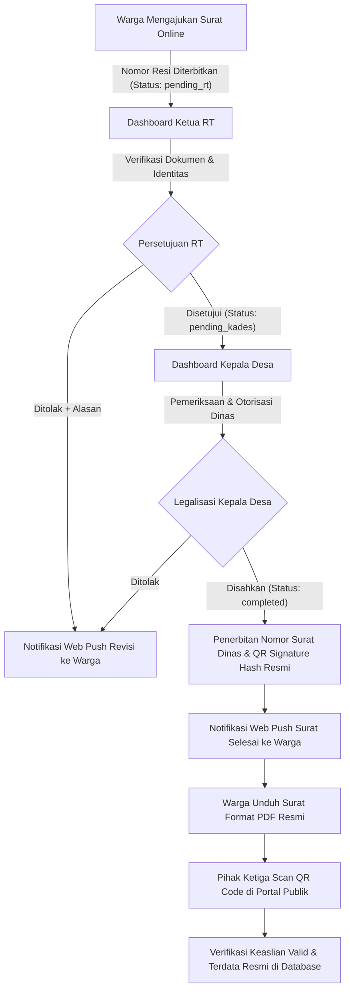

<div align="center">
  <!-- Header Banner: Animated Dark Emerald Wave with Twinkling Stars & High-Contrast Crisp Typography -->
  

  <br/>

  <!-- Dynamic Typing SVG -->
  <a href="https://github.com/genthaandikaa/SiDesKu">
    
  </a>

  <br/><br/>

  <!-- Badges Grid -->
  <p>
    
    
    
    
    
    
    
  </p>

  <p>
    
    
    
    
  </p>
</div>

---

## 📌 Daftar Isi
- [Tentang SiDesKu](#-tentang-sidesku)
- [Masalah yang Diselesaikan](#-masalah-yang-diselesaikan)
- [Fitur Utama](#-fitur-utama)
- [Matriks Hak Akses (Role-Based Access Control)](#-matriks-hak-akses-role-based-access-control)
- [Alur Kerja Layanan Surat (Workflow Diagram)](#-alur-kerja-layanan-surat-workflow-diagram)
- [Teknologi & Arsitektur](#-teknologi--arsitektur)
- [Struktur Direktori](#-struktur-direktori)
- [Panduan Instalasi & Menjalankan](#-panduan-instalasi--menjalankan)
- [Akun Demo Pengujian](#-akun-demo-pengujian)
- [Referensi Endpoint API](#-referensi-endpoint-api)
- [Kontribusi](#-kontribusi)
- [Lisensi](#-lisensi)

---

## 🏛️ Tentang SiDesKu

**SiDesKu** (*Sistem Informasi Desa Terpadu*) adalah platform *Smart Village & E-Government* berbasis web modern yang dirancang untuk mentransformasi birokrasi konvensional di tingkat desa menjadi sistem administrasi digital yang **efisien, transparan, akuntabel, dan bebas pemalsuan**.

Platform ini mengintegrasikan seluruh ekosistem pelayanan desa—mulai dari warga masyarakat di tingkat Rukun Tetangga (RT), pengurus Rukun Warga (RW), hingga jajaran perangkat pemerintah desa (Sekretaris Desa, Kepala Desa, dan Bendahara Desa)—ke dalam satu pintu layanan terpadu (*single-window service*).

---

## 💡 Masalah yang Diselesaikan

| Tantangan Konvensional | Solusi Digital SiDesKu |
| :--- | :--- |
| **Birokrasi Rumit & Antrean Fisik:** Warga harus bolak-balik mendatangi rumah RT, RW, lalu ke balai desa hanya untuk selembar surat pengantar. | **Pengajuan Mandiri Online:** Warga dapat mengajukan surat kapan saja via smartphone/laptop dengan pelacakan nomor resi otomatis. |
| **Resiko Dokumen Palsu:** Tanda tangan dan stempel basah rawan dipalsukan. | **Verifikasi Tanda Tangan QR Code Kriptografis:** Dokumen resmi disahkan dengan QR Code unik ber-hash yang dapat diverifikasi keasliannya oleh instansi publik (Bank, Dispendukcapil, Sekolah) secara real-time. |
| **Status Surat Tidak Jelas:** Warga sering bingung apakah permohonan sudah diproses atau terhambat. | **Live Tracking Resi Berjenjang:** Warga dapat memantau status secara presisi (Diajukan $\rightarrow$ Diverifikasi RT $\rightarrow$ Validasi RW $\rightarrow$ Legalisasi Sekdes $\rightarrow$ Terbit). |
| **Ketidakterbukaan Anggaran Desa:** Informasi APBDes dan Bansos jarang diakses warga secara transparan. | **Portal Transparansi Publik:** Dashboard visual interaktif realisasi APBDes serta transparansi data penerima program Bantuan Sosial (Bansos). |
| **Pencatatan Iuran RT yang Tercecer:** Kas RT masih dicatat pada buku fisik yang rawan hilang. | **Buku Kas RT Digital:** Pencatatan otomatis iuran, pengeluaran, serta laporan neraca kas RT secara real-time. |

---

## ✨ Fitur Utama

### 1. 📄 Layanan Persuratan Digital Multi-Tier (*E-Surat*)
* **Katalog Surat Lengkap:** Menyediakan berbagai jenis surat resmi desa:
  * Surat Keterangan Tidak Mampu (SKTM)
  * Surat Keterangan Usaha (SKU)
  * Surat Keterangan Domisili (SKD)
  * Surat Pengantar KTP-el & Kartu Keluarga (KK)
  * Surat Keterangan Nikah (Model N1 - N4)
  * Surat Keterangan Kelahiran & Kematian
  * Surat Izin Keramaian & Surat Pengantar Umum lainnya
* **Penerbitan Nomor Surat Otomatis:** Generator penomoran dinas terstandarisasi Permendagri (format kode klasifikasi/nomor urut/kode wilayah/tahun).
* **Unduh & Cetak PDF Resmi:** Dilengkapi Kop Surat dinas resmi, logo kabupaten, detail pemohon, stempel desa, dan QR Code tanda tangan digital.

### 2. 🔐 Verifikasi Keaslian Dokumen QR Code Publik (*Anti-Forgery*)
* Setiap surat yang disahkan menghasilkan *digital signature hash* unik.
* Portal publik **Lacak & Verifikasi QR**: siapapun dapat memindai QR Code menggunakan kamera smartphone atau menginput hash untuk memvalidasi keabsahan dokumen tanpa perlu login ke sistem.

### 3. 📦 Tracking Resi Pengajuan Surat Real-Time
* Warga mendapatkan **Nomor Resi Unik** (misal: `REQ-20260818-001`) seketika saat pengajuan dikirim.
* Pelacakan linimasa status secara transparan (*Pengajuan Warga $\rightarrow$ Persetujuan Ketua RT $\rightarrow$ Legalisasi & TTD QR Kepala Desa $\rightarrow$ Siap Unduh PDF*).

### 4. 🔔 Notifikasi Real-Time Web Push & PWA (Progressive Web App)
* **Rp0 Biaya Operasional (Zero-Cost):** Menggunakan standar industri W3C Web Push & VAPID RFC 8291/8292 langsung ke push service browser (FCM Google Chrome, Mozilla autopush, Apple WebPush Safari) tanpa pihak ketiga berbayar.
* **Instalasi PWA 1-Klik:** Aplikasi dapat diinstal langsung di layar utama smartphone (Android/iOS) dan desktop seperti aplikasi native.
* **Push Notification Lintas Perangkat:** Notifikasi instan diterima warga dan aparatur desa saat ada pengajuan surat masuk, surat disetujui, pengumuman darurat, agenda desa, dan penyaluran bansos—bahkan saat browser atau tab tertutup.
* **Privasi Ketat:** Payload push notification terisolasi per tenant desa dan bebas PII (tidak membawa NIK atau isi sensitif warga).

### 5. 📊 Transparansi Keuangan Desa (APBDes)
* Visualisasi grafik interaktif realisasi Anggaran Pendapatan dan Belanja Desa.
* Breakdown terperinci: **Pendapatan Desa** (PAD, Dana Desa, Alokasi Dana Desa), **Belanja Desa** (Bidang Pemerintahan, Pembangunan, Pembinaan Kemasyarakatan), dan **Pembiayaan**.

### 6. 🤝 Manajemen Bantuan Sosial (Bansos) Terbuka
* Manajemen alokasi program bantuan: PKH, BLT Dana Desa, BPNT, Bantuan Sembako.
* Filter data penerima berbasis kelayakan ekonomi, status verifikasi lapangan, dan integrasi broadcast pengumuman.

### 7. 💵 Buku Kas & Iuran Warga Tingkat RT
* Pencatatan arus kas masuk (iuran sampah, jimpitan, dana sosial) dan kas keluar (pembangunan pos ronda, kerja bakti).
* Rekapitulasi saldo kas RT real-time yang dapat diakses oleh pengurus RT.

### 8. 📢 Kanal Informasi Publik & Pengaduan Warga
* Publikasi agenda kegiatan desa, berita terkini, dan pengumuman mendesak.
* Form aspirasi & pengaduan masalah warga (infrastruktur, lampu jalan, ketertiban) yang langsung terhubung ke pengurus RT terkait.

---

## 👥 Matriks Hak Akses (Role-Based Access Control)

| Peran / Role | Hak Akses & Tanggung Jawab Utama |
| :--- | :--- |
| **🌐 Tamu / Publik** | Akses landing page, baca berita & profil desa, lacak resi surat, verifikasi QR Code keaslian dokumen, lihat ringkasan transparansi APBDes. |
| **👨‍👩‍👧 Warga** | Mengajukan surat online mandiri, melacak status resi, unduh PDF surat resmi berstempel QR, kirim aspirasi/pengaduan ke RT, dan cek status bansos. |
| **📋 Ketua RT** | Verifikasi & setujui pengantar surat warga RT (pending_rt $\rightarrow$ pending_kades), kelola data KK/warga RT, kelola Buku Kas & iuran RT, tanggapi pengaduan. |
| **🏢 Ketua RW** | Monitoring demografi warga & koordinasi lingkungan tingkat Rukun Warga. |
| **🏛️ Sekretaris Desa (Sekdes)** | Tata laksana administrasi umum desa, buku register KK/warga, arsip surat sah, penerbitan surat mandiri di loket, manajemen kop surat, dan program bansos. |
| **👑 Kepala Desa (Kades)** | Eksekutif & legalisasi akhir persuratan desa (pending_kades $\rightarrow$ completed), penandatanganan stempel QR resmi desa, kebijakan & pengumuman penting. |
| **💰 Bendahara Desa** | Menginput pos anggaran, mencatat realisasi belanja & pendapatan desa, mempublikasikan laporan APBDes ke masyarakat. |
| **⚙️ Administrator** | Akses penuh master data sistem, manajemen pengguna, master jenis surat, konfigurasi kop surat dinas, dan audit log sistem. |

---

## 🔄 Alur Kerja Layanan Surat (Workflow Diagram)



---

## 🛠️ Teknologi & Arsitektur

### Frontend Ecosystem
* **Core:** [React 19](https://react.dev/) + [TypeScript](https://www.typescriptlang.org/)
* **Build Tooling:** [Vite](https://vitejs.dev/) (Fast HMR & Optimized Bundler)
* **Styling:** [Tailwind CSS v4](https://tailwindcss.com/) (Modern CSS Grid & Flex Layouts)
* **Routing:** [React Router v6](https://reactrouter.com/) (Protected Routes & Code Splitting)
* **Iconography:** [Lucide Icons](https://lucide.dev/)
* **Architecture:** *Feature-Driven Architecture* (`features/auth`, `features/surat`, `features/dashboard`, `features/keuangan`, `shared/`)

### Backend Ecosystem
* **Core Framework:** [Laravel 13](https://laravel.com/) (Expressive PHP Framework)
* **Runtime:** PHP 8.4+
* **Authentication:** [Laravel Sanctum](https://laravel.com/docs/sanctum) (Secure Bearer Token Authentication)
* **Database:** MySQL 8.x / MariaDB
* **Digital Signature & QR:** SVG QR Code Generator dengan hashing SHA-256
* **Architecture:** Modular Role-Based RESTful API Controllers (`Api/Admin`, `Api/Warga`, `Api/Rt`, `Api/Rw`, `Api/Sekdes`, `Api/Bendahara`, `Api/Public`)

---

## 📂 Struktur Direktori

```text
SiDesKu/
├── backend/                       # RESTful API Backend (Laravel 13)
│   ├── app/
│   │   ├── Http/
│   │   │   ├── Controllers/Api/   # Controller terbagi rapi berdasarkan Role
│   │   │   │   ├── Admin/         # Manajemen User, Warga & Pengaturan Kop Surat
│   │   │   │   ├── Auth/          # Login, Register & Profil Pengguna
│   │   │   │   ├── Bendahara/     # Realisasi & Kategori APBDes
│   │   │   │   ├── Public/        # Tracking Resi, Berita, Verifikasi QR Code
│   │   │   │   ├── Rt/            # Verifikasi Surat RT, Kas RT, Pengaduan
│   │   │   │   ├── Rw/            # Verifikasi Pengantar RW
│   │   │   │   ├── Sekdes/        # Legalisasi Surat, QR TTD, Program Bansos
│   │   │   │   └── Warga/         # Pengajuan Surat Mandiri & Pengaduan
│   │   │   └── Middleware/        # RBAC & Sanctum Route Guards
│   │   └── Models/                # Eloquent Models (Surat, User, APBDes, dll.)
│   ├── database/
│   │   ├── migrations/            # Skema Database Terstruktur
│   │   └── seeders/               # Data Awal Lengkap (Role, Desa, Akun Demo)
│   └── routes/
│       └── api.php                # Definisi Endpoint REST API
│
├── frontend/                      # Single Page Application (React 19 + TypeScript)
│   ├── src/
│   │   ├── assets/                # Aset Gambar, Logo & Ilustrasi
│   │   ├── features/              # Feature-Driven Modules:
│   │   │   ├── auth/              # Login & Register Forms
│   │   │   ├── bansos/            # Tampilan Program Bantuan Sosial
│   │   │   ├── dashboard/         # Dashboard Layout & Panel Khusus Per Role
│   │   │   ├── desa-setting/      # Pengaturan Kop Surat & Info Pemdes
│   │   │   ├── keuangan/          # Modul APBDes & Buku Kas RT
│   │   │   ├── landing/           # Halaman Publik, Tracking & Verifikasi
│   │   │   ├── pengaduan/         # Form Aspirasi & Respon Keluhan
│   │   │   ├── surat/             # Form Pengajuan Surat & Detail Pelacakan
│   │   │   └── warga/             # Manajemen Penduduk & Kartu Keluarga
│   │   ├── shared/                # Shared Components, Context & Utilities
│   │   ├── App.tsx                # Konfigurasi Rute Aplikasi
│   │   └── main.tsx               # Entry Point
│   └── package.json
└── README.md                      # Dokumentasi Utama Repository
```

---

## ⚡ Panduan Instalasi & Menjalankan

### 1. Prasyarat Sistem
Pastikan perangkat Anda telah terpasang:
* **PHP** $\ge$ 8.2 (disarankan PHP 8.4)
* **Composer** $\ge$ 2.x
* **Node.js** $\ge$ 18.x & **npm**
* **MySQL** $\ge$ 8.0 atau **MariaDB** $\ge$ 10.4

---

### 2. Konfigurasi Backend (Laravel)

```bash
# 1. Masuk ke direktori backend
cd backend

# 2. Salin file konfigurasi environment
cp .env.example .env

# 3. Install dependensi PHP via Composer
composer install

# 4. Generate Application Encryption Key
php artisan key:generate

# 5. Konfigurasi Database di file .env:
# DB_CONNECTION=mysql
# DB_HOST=127.0.0.1
# DB_PORT=3306
# DB_DATABASE=sidesku_db
# DB_USERNAME=root
# DB_PASSWORD=

# 6. Jalankan migrasi tabel dan seeding data dummy lengkap
php artisan migrate:fresh --seed

# 7. Jalankan server lokal Laravel
php artisan serve
```
> Server backend berjalan di: `http://localhost:8000`

---

### 3. Konfigurasi Frontend (React + Vite)

```bash
# 1. Buka terminal baru dan masuk ke direktori frontend
cd frontend

# 2. Install dependensi Node.js
npm install

# 3. Jalankan server pengembangan Vite
npm run dev
```
> Antarmuka web frontend dapat diakses di browser: `http://localhost:5173`

---

## 🔑 Akun Demo Pengujian

Setelah menjalankan `php artisan migrate:fresh --seed`, Anda dapat langsung login menggunakan akun pengujian berikut:

> **Kata Sandi (Password) untuk SEMUA akun di bawah ini adalah:** `password123`

| Peran (Role) | Username | Email | Kegunaan Pengujian |
| :--- | :--- | :--- | :--- |
| **Administrator** | `admin` | `admin@sidesku.desa.id` | Konfigurasi master data, template kop surat, dan user sistem. |
| **Kepala Desa** | `kades` | `kades@sidesku.desa.id` | **Legalisasi & TTD QR Resmi permohonan surat warga, penetapan kebijakan & pengumuman.** |
| **Sekretaris Desa** | `sekdes` | `sekdes@sidesku.desa.id` | **Tata laksana administrasi, register KK/warga, arsip surat, buat surat mandiri loket, dan Bansos.** |
| **Bendahara Desa** | `bendahara_desa` | `bendahara.desa@sidesku.desa.id` | **Input realisasi pos APBDes dan pembukuan keuangan.** |
| **Ketua RW 01** | `rw01` | `rw01@sidesku.desa.id` | **Monitoring demografi & koordinasi lingkungan tingkat RW.** |
| **Ketua RT 01** | `rt01` | `rt01@sidesku.desa.id` | **Persetujuan awal surat pengantar (pending_rt $\rightarrow$ pending_kades) & kelola Kas RT 01.** |
| **Warga 1 (Pemohon)**| `warga01` | `warga01@sidesku.desa.id` | **Mengajukan surat SKTM/SKU, cek resi, dan unduh PDF surat.** |
| **Warga 2** | `warga02` | `warga02@sidesku.desa.id` | Pengajuan surat domisili dan kirim aspirasi pengaduan. |

---

## 📡 Referensi Endpoint API

Berikut adalah beberapa endpoint representatif dari sistem SiDesKu:

### 🌐 Publik (Tanpa Autentikasi)
| Metode | Endpoint | Deskripsi |
| :--- | :--- | :--- |
| `GET` | `/api/public/home` | Statistik ringkas demografi desa & banner publik |
| `GET` | `/api/public/surat/track?resi={resi}` | Lacak status pengajuan surat berdasarkan nomor resi |
| `GET` | `/api/public/surat/verify-qr/{hash}` | Verifikasi keaslian dokumen & keabsahan tanda tangan QR |
| `GET` | `/api/public/apbdes/summary` | Ringkasan grafik transparansi keuangan APBDes |
| `POST` | `/api/auth/login` | Otentikasi pengguna & penerbitan token Sanctum |

### 🔒 Terproteksi (Bearer Token Sanctum)
| Metode | Endpoint | Role Diizinkan | Deskripsi |
| :--- | :--- | :--- | :--- |
| `GET` | `/api/surats` | Warga, RT, RW, Sekdes | Daftar permohonan surat sesuai cakupan hak akses |
| `POST` | `/api/surats` | Warga | Mengajukan permohonan surat baru mandiri |
| `POST` | `/api/surats/{id}/approve-rt` | RT | Persetujuan surat pengantar tingkat RT (pending_rt $\rightarrow$ pending_kades) |
| `POST` | `/api/kades/surat/{id}/approve` | Kades | Penerbitan nomor surat resmi & legalisasi QR Code tanda tangan Kepala Desa |
| `POST` | `/api/kades/surat/{id}/reject` | Kades | Penolakan permohonan surat disertai catatan revisi dinas |
| `POST` | `/api/webpush/subscribe` | All Roles | Pendaftaran token VAPID Web Push perangkat untuk notifikasi real-time |
| `GET` | `/api/kas-rt` | Pengurus RT | Laporan arus kas iuran warga RT |
| `POST` | `/api/bansos/{id}/publish-broadcast`| Sekdes | Publikasi program bansos & broadcast pengumuman |
| `POST` | `/api/apbdes/records` | Bendahara | Mencatat pos realisasi anggaran desa |

---

## 🤝 Kontribusi

Kontribusi dari sesama pengembang sangat diapresiasi! Untuk berkontribusi:
1. *Fork* repositori ini
2. Buat branch fitur baru (`git checkout -b feature/NamaFiturKeren`)
3. Lakukan commit perubahan Anda (`git commit -m 'feat: menambahkan modul notifikasi telegram'`)
4. *Push* ke branch Anda (`git push origin feature/NamaFiturKeren`)
5. Ajukan *Pull Request* baru

---

## 👨‍💻 Pengembang & Tim

* **Gentha Andika Pratama** ([@genthaandikaa](https://github.com/genthaandikaa)) — Full Stack Web Developer & System Architect
* Tim Pengembang Inovasi Digital Desa

---

## 📄 Lisensi

Proyek ini dilisensikan di bawah **[MIT License](LICENSE)**. Bebas digunakan, dikembangkan, dan diimplementasikan untuk kemajuan digitalisasi desa di seluruh Indonesia.

<div align="center">
  <br/>
  <!-- Animated Footer Wave -->
  
</div>
